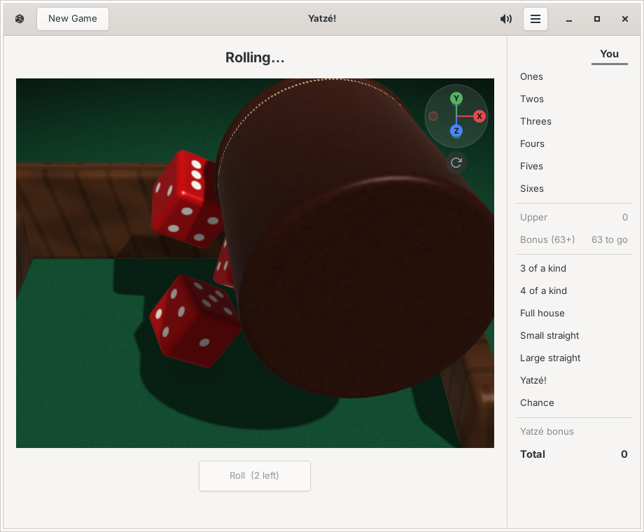
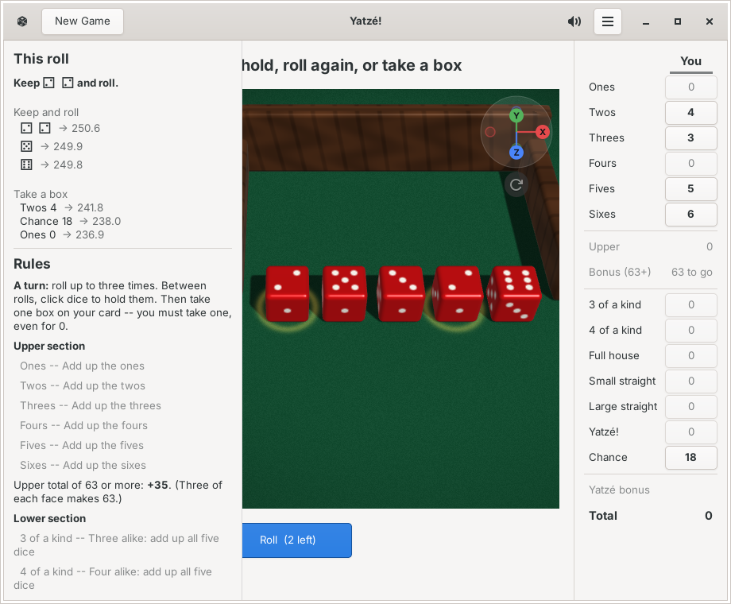
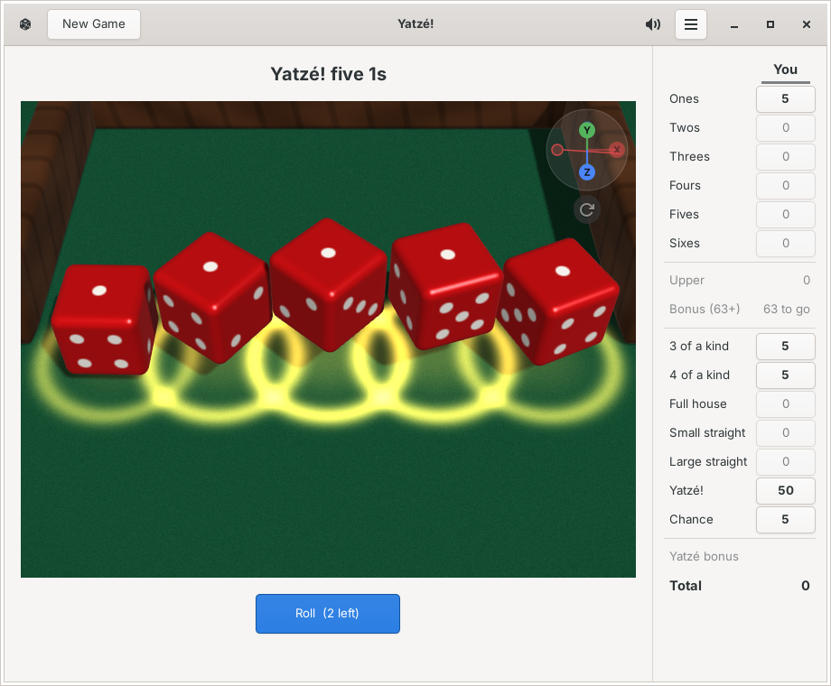
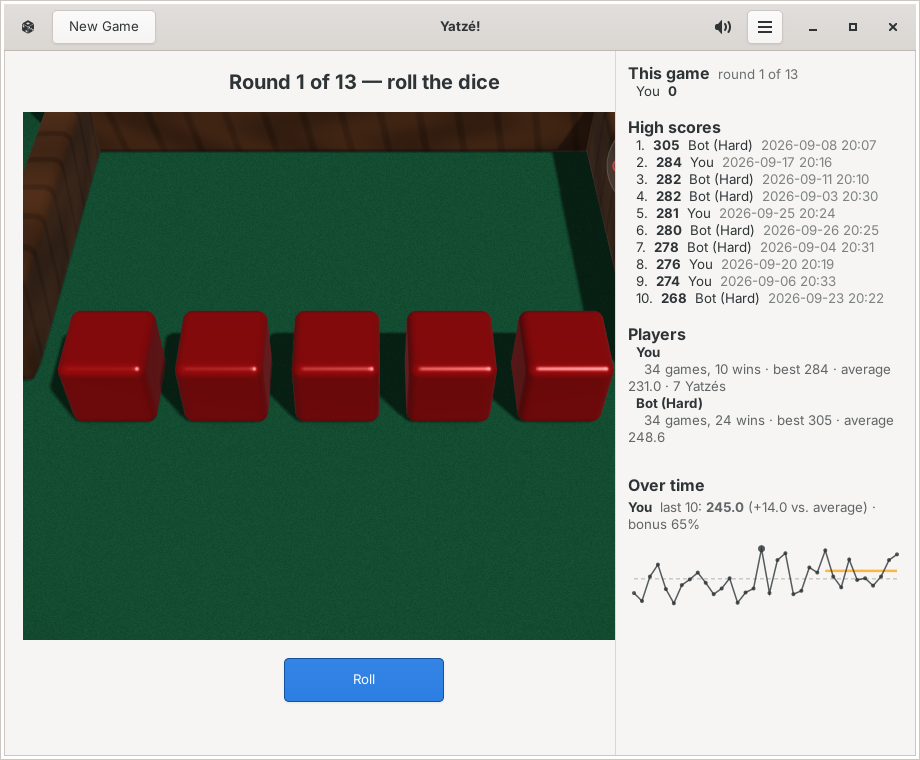

# Yatzé!

A dice game for GNOME: five dice, thirteen boxes, three rolls a turn.
gtkmm 4 / C++23. Started from the Cairn seed.

**1.1.0.** The full game -- upper bonus, Yatzé bonuses, the forced Joker --
for 1–6 seats of people and computer players (Easy / Medium / Hard; Hard
plays optimally), with live hints from an exact strategy engine.

Every roll is poured from a leather cup into a wooden tray and is real
tumbling physics, filmed from your seat with a camera planned around how
it ends, with real shadows and the clatter of every knock (synthesised,
no sound files). Then the dice line up, results on top, to read. Turn the
table to look from any side. A Yatzé gets a cheer.



| | |
|---|---|
|  |  |
| Hints: what to keep, which box to take | A Yatzé |
|  | |
| High scores, records, your games over time | |

OpenGL 3.3 for the table (flat dice if it isn't available).

## Build & run

```
./build.sh
./build/yatze_selftest     # the rules and the game, headless
./build/yatze
```

Deps (Fedora): `gtkmm4.0-devel spdlog-devel libepoxy-devel cmake gcc-c++`
(sound plays through GTK's GStreamer media backend, there by default on GNOME).
Deps (Ubuntu/Debian): `libgtkmm-4.0-dev libspdlog-dev libepoxy-dev cmake g++`.

## Install (for the GNOME overview)

```
./install.sh        # builds Release, installs to ~/.local, refreshes the caches
./uninstall.sh      # removes it (your games, players and settings stay)
```

## Playing

- **R** or the Roll button rolls every die not held; three rolls a turn.
- Click a die (or press **1–5**) to hold it; it steps forward on a blue ring.
- Menu › **Red dice** / **Ivory dice**. Sound: the speaker button in the
  header, **M**, or Menu › **Dice sounds** (remembered).
- **The orb** (top-right of the table): drag it to turn the table; click an
  axis to look along it (Y = straight down, handy for reading the dice);
  **Home** or the button under it for the standard view.
- Menu › **Computer: watch every roll** / **quicker** -- how fast the
  computer's turns play.
- Menu › **Clear high scores…** (asks first).
- The scorecard shows what each open box would score; click one to take it
  -- the points fly from the table into the box.
- With two or more seats, a card over the table says whose turn it is.
- **Ctrl+Z / Ctrl+Shift+Z** undo / redo a hold or the box you took. A roll
  is final.
- **Shift+F9** standings: this game, the high scores, every player's record
  (games, wins, best, average), and each person's games over time (the last
  ten against their average). It opens by itself when a game ends.
- **F9** hints and rules (the advised dice glow amber on the table, or the
  advised box is outlined), **Esc** closes.
- **Ctrl+N** new game, same players; **Ctrl+Shift+N** choose the players
  (people, or the computer at Easy / Medium / Hard).
- **Ctrl+?** lists every key. `YATZE_DEBUG=1 ./build/yatze` logs in detail;
  `YATZE_SPEED=10` plays everything ten times faster, `YATZE_SEED=1667` deals
  the same dice every game (1667 opens with a Yatzé) -- both for testing.

"Yatzé!" is this game's name; it is not affiliated with Hasbro's Yahtzee®.

## License

MIT -- see LICENSE.
